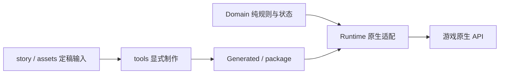

# 项目手册

这是当前项目需求、架构和工作流程的唯一说明入口。用户的新决定优先；接受变更后先更新对应定稿输入和本手册，再修改实现。历史说明、下载目录里的草稿和 `.dev` 里的反编译参考不能覆盖当前定稿。生成文件和测试报告也不构成新需求。

## 当前范围

当前版本以 `package/XiaomanVisitor/manifest.xml` 为准，不在多份说明中重复维护版本号。工坊条目 `3835383562` 的发布基线保存在 `main`，每次发布以 `v*` 标签留档；开发使用 `develop/tavern`。`baseline/native-render-0.0.3.3` 保存作者确认清晰的渲染方案，`baseline/pre-architecture-0.0.3.4` 保存本次整理前的工程。

| 状态 | 内容 |
| --- | --- |
| 基础流程 | 十四次来访、固定预算、三语、次日纸条及磁带、六款三日效果饮品、信笺簿、磁带盒已实现。新版酒馆剧情完成第1–11章，第12–14章仍沿用v3.4旧稿待重构；不能把基础十四章流程当作新剧情全部完成。录音与明确待录的数量以当前报告为准。 |
| 第一周重构 | 已确认中文与赠礼规则，按周接入。保留原有六句口头台词及录音，新增两句磁带话题暂仅字幕；首封信改为分享重复磁带。第三天起有匿名装修简讯；地图遵守实验性开关，第三天前隐藏，之后显示装修中且不可进入。普通回礼酒仍按原条件获得。 |
| 第二周开发 | v4.1 已实现并通过离线与本机原生API检查，实机由作者验收。第3–7天装修，第8天夜间开业；六酒现场饮用、每日一杯、独立一次性开业接待、雨幕与选曲。本轮不改工坊基线。 |
| 第三周开发 | v4.4 已接入第15天起有薪夜班、第三次会面及次日A/B信、每班35%判定、每周最多一次感谢；保持原文，不增加第三种信。离线与本机原生API检查通过；作者已明确要求安装本机供测试，不上传工坊，实机仍由作者操作。 |
| 第四周开发 | v4.6-W04：两份约定；第22天NEWS及原生电话、第25天集团协议、第26天申请拒绝公函、第27天起王哥来访；水与原材料真实供销、生产分流；第四封A/B与intro2。新日语待审不录音，经济仅首测值，不实现融资账。 |
| 第五、六周开发 | 第五周 v4.7 高档酒与独立即兴赠品；第六周以作者最终讨论及确认的回望初遇信为准，接入原生推荐买家。开发分支制作，不改工坊基线，不请求新配音。 |
| 第七、八周开发 | v4.8：第七周熟客与故乡合照；第八周当面拍照、次日发夹趣事，消息修订覆盖附件旧信。只增加文字与少量闲聊，不扩展玩法；中日英接入，新日语待审不录音。 |
| 第九周开发 | 最后修订“再多进一点吧”：第57天极昼开业NEWS，小满仍然繁忙，次日制冰机愿望信；探店/衰退留到后续。只增加新闻、对白与连续闲聊，不改既有订单、库存、货款及玩法。 |
| 第十周开发 | 去喝了一杯：400 CR买水、gallery2；认可极昼品质，仍认为折扣会结束；次日推迟制冰机的原文信。库存闲聊只读实际记录选词，熟客回访闲聊需会面两天后。新日语待审，不生成录音。 |
| 第十一周开发 | 第二次修订“十二点”：350 CR日用品、deepnight；极昼促销延长NEWS，三句推广承诺闲聊，次日向前辈袒露经营迷茫的原文信。作者明确十二点仅为剧情，不改夜访规则、地图说明或场景。新日语待审。 |
| 后续计划 | 第十二周起逐周定稿；旧章节不作为提前实现债务、关系等级等新功能的依据。 |
| 候选设计 | NPC 订单、客流项目、隔间转租、贷款重组、留下分支、分红和物业收购尚未实现。参考 `docs/design` 与 `story/酒馆设计`，不得描述为现有功能。 |

来访按实际见面推进：周一未营业或没见到小满就保留章节；首次开场真正播放后推进一次。她追加到原生队尾，不减少名额，不越过其他剧情顾客。同一天不能重复推进。剧情赠礼不要求成交，次日投递；放不下时保留断点，读档不能重复发放。

酒馆开关使用原生模组配置 `experimental_tavern`，初始值为关闭；每次启用模组时读取并固定本次会话的选择，更改后重启生效。关闭时不注册地点、不创建场景，也不初始化酒馆存档。过去的酒馆记录保留，重新开启后继续；十四次周一来访、纸条、磁带和回礼酒独立运行。

动态酒馆以作者提供的 Animation Kit v1.1 原画与玻璃遮罩为依据，纳入 `assets/tavern-scene`；`scene.json` 统一画布、人物位置、环境循环参数和交互物件位置。第二周接入小满、雨幕与磁带机的透明命中区，坐标从同一布局生成；取货架、水槽与管线继续预留。环境在离线阶段生成，运行模组不依赖 Python、OpenCV 或 FFmpeg。

撤下旧 `tavern_scene_preview` 第一天入口，旧配置即使保存为开启也不能绕过日历。保留默认关闭、重启生效的实验性酒馆总开关；第1–2天隐藏，第3–7天以“商业街神秘新店”显示装修与配图，第8天起为“小满酒馆”，按原生夜访流程进入并显示原生背包。已有离站结局不复活。开放不依赖见面、成交或读信，周一剧情仍按实际会面推进；第8天之后才发生的第二次会面用延迟开业台词。

第二周场景以点击小满打开“酒单／互动／只是看看”，互动内有闲聊及第8–14天一次性“帮忙接待客人”；另有雨幕和磁带机命中区。台词仍在原生气泡逐句显示。首访、同夜重入与闲聊使用独立存档，不以夜访次数发主线礼物；不认识小满时不用“前辈”。旧35 CR普通杯、取餐台和账本退出界面，`tavern_v1_progress` 原键内迁移到新版本并保留历史，旧帮助不算新事件。

2026-11-10 实机修正：酒馆场景放在原生窗口画布的底层，避免meta整屏图片遮住“地面／口袋／背包”；原生夜访负责物品转入与返回回收，面板只增加背包显示开关。点击小满及互动、确认帮助用原生选择气泡的独立副本；酒单为卡片窗口，供销为工具窗口，选曲复用原生磁带机。选择副本移除原生会话回调，不调用原生当前顾客的SelectChoice。所有章节购物字幕使用当次固定初始预算替换占位符，不受已消费余额影响。新纸条与磁带先投柜台；柜台满时才尝试对应收纳容器及原有后备位置，成功投递使用原生提示，旧已收纳物品不移动、不重发。

酒单复用六款酒及三日效果，现场喝掉而不创建物品；价格从 `assets/tavern-prices.json` 单一输入生成，首测果汁95、酒精190 CR。按游戏日限一杯，帮助与喝酒互不排斥。消费先保存稳定交易ID与钱包/Buff快照，再扣款与提交效果；可精确辨认的中断恢复不重新扣钱，无法辨认的记录锁定消费，优先避免重复结算。酒精版仅对原本已成瘾者沿用缓解，果汁版不触发酒精处理。音乐复用已装入的原有音源；酒馆磁带盒每次仅提供当前实际剧情章对应的一盘（第二章Intro、第三章Nightfall），不累积旧曲；周一缺席随剧情顺延，尚未结识时用Title。入场背景曲也按当前章节重新选择，覆盖旧存档的过期选曲。临时磁带只在盒内与原生播放区之间移动，同次进店反复开关窗口不生成新物品，离场销毁，不写入玩家收藏；离场恢复原音乐的播放状态。

本轮不生成付费录音。新增或改写日语明确暂缓，语音索引只保留匹配的旧录音；新夜间台词和未相识称呼变体一并进入待录清单。纸条第二封保留两组颜文字，必要时只为缺少的颜文字字符回退字体，仍用悠哉正文。

第三周按日历第15天开放付薪工作，与第三次会面和饮酒限额无关。首测需求源是独立的船坞换班溢出订单计划：夜间生成并持久化每日有限订单，每单拥有唯一ID和收入归属；不是完整NPC客流引擎，不计入基础客流或L1。参数由 `assets/tavern-work.json` 统一维护，可以将某日需求设为0；菜单刷新不生成订单。当前一班履约3单，销售195、材料90、工资60、增量净额45，工作演出约3秒；取消未提交的演出不结算，重复回调和重入只认同一班次回执。

用户于2026-11-10再次确认：第三次有效会面的当晚完成且已结算工资用B，否则A，次日固定后投递；两封中文原文保留，不另加中性信。过去已打工只替换第三次邀请对白。B只增加文字层，不增加纸条物品ID、磁带或赠礼份数；补投沿用已固定版本，旧已发纸条按A迁移。

每班成功结算后，以原生runID与班次ID固化35%感谢抽签和一款基础果汁；每游戏周最多中奖并来访一次。同一班次不重抽，未中奖允许后续班次再判定，待访与未交付礼酒先保留。中奖次日起排队，非周一作为独立work_thanks顾客追加队尾；周一优先合并进正常小满来访，不额外加预算或推进章节。特殊来访的100 CR采购是一次私人预留金，单独记录实际支出，不计酒馆营业收入或主线预算。赠品封装酒独立于采购与主线奖励，满载保留待交付。每日随机事件、长期项目、关系等级、债务、可见新客人立绘仍不做。

场景使用一条无音轨环境循环与静态后备图，雨水、灯光、吧台和地板反光，以及作者v1.1包中的磁带机电平柱、转轮高光、局部光晕一起合成，最后仅编码一次。选曲和室内音源已接入，画内电平仍为装饰节奏，不声称跟随真实音频。室内音乐用独立音源并在语音播放时降低音量；只临时静音原生音乐通道，不停止其自动切曲协程，离场恢复静音状态。人物复用既有图集与口型，吧台前景与背景采样同一视频纹理，准备阶段或失败时显示同构图静态图。离场停止并释放解码资源，实验性选项关闭时不分配场景或播放器。

作者反馈人物与场景比例稍显靠前，本轮将酒馆人物按 7/8 等比缩小（384×688 → 336×602），保持水平中心与吧台后腰线不动，让头肩自然下移；仅调整酒馆布局，不改变原图集、口型帧或店铺人物尺寸。遮挡片与视频 UV 跟随同一布局重新生成。

作者进一步要求增强场景生命感：吊灯、顶灯、霓虹、吧台及地板反光分别控制强度与相位，变化要能在正常观看时察觉，避免整屏统一明暗。参数统一在 `scene.json/animation/lighting`，原画不重绘，磁带机动效继续保留。

2026-11-09 的玩家日志出现 `WindowsVideoMedia ... Color Standard: 0`，旧视频的 H.264 码流也确有未指定的原色与传递特性（值2）。制作程序现对滤镜帧、编码器及容器同时明确 BT.709，并在输出检查中读取码流确认三项均为1。依据 [FFmpeg setparams 源码](https://ffmpeg.org/doxygen/trunk/vf__setparams_8c_source.html)。这修复了素材的标记缺口，是否消除本机游戏警告仍由下一次实机日志验证，不能把旧警告断言为所有观感问题的原因。

酒馆人物增加独立呼吸起伏，使用现有动画开关。参考依据是原作 `TRP_SkitMZ_Config` 中 `loopfloat` 的上下位移缓动宏（±10、各45帧），不据此断言原作每个场景都启用它。此处按酒馆比例采用4秒一周期、最多8个参考画布像素的平滑上移再回落，约为底图2.7像素；不拉伸身体、不改变表情帧，腰部始终在吧台后。气泡锚点保持静止，离场复位；呼吸、眨眼、配音与环境循环使用各自时钟，不把人物烘焙进背景视频。

作者实测认可环境与呼吸后，要求人物也受到酒馆光线影响，并进一步反馈首版过轻。酒馆演员使用原生 UI 顶点色渐变：上部暖光、靠窗侧冷蓝、衣服下缘粉紫反光，面部中央降低染光幅度。增强版让亮部可以超过原画亮度，避免仅压低颜色导致帽子发灰：RGB 表以 `gain_scale=1.75` 留出提亮范围，同一演员独占一份原生 UI 材质副本，仅设置 `_Color` 的 RGB 倍率，透明度保持1；不改共享材质，停用恢复、销毁释放。使用 [Unity 的向量属性接口](https://docs.unity3d.com/2021.3/Documentation/ScriptReference/Material.SetVector.html) 避免颜色空间的自动转换。仍为15个顶点、100帧、4500字节 RGB 数据，不新增角色贴图、着色器、叠层或后处理；未测量实际帧率，不能据此宣称零性能开销。

离线从同一环境动画的灯源区域采样；运行时按视频实际显示帧读取，暂停或静态后备均保持对应颜色，不使用独立呼吸时钟驱动灯光。只对酒馆独立演员生效，保留原图集、透明度、呼吸和表情，不做 GPU 回读。该效果为二维环境染光，不是三维投影或真实遮挡阴影；离线合成只用于对比，最终亮度和连续播放观感由作者实机验收。

第一周采用“还亮着灯”的既有开场，不主动介绍开店。新加 `xm_01_04`、`xm_01_05` 承接磁带机话题，明确标记“暂不配音”；沿用录音的句子不改日语问候。纸条标题为“致店长先生：”，雨天句为“这首歌，是我在故乡下大雨的时候常听的。”，Title 磁带与首次信笺簿、磁带盒照常次日投递，与成交无关。后续周一缺席仍顺延。新句不借用不匹配的旧录音，不请求 TTS；录音校验只容许显式延后制作的缺口，其余缺失或过期仍报错。

装修简讯按游戏日历第3–7天出现在原生NEWS空余版位，与见面、交易及是否读信无关；原生新闻满四条时保留原内容。仅在报纸展示副本中追加，不激活世界事件、不改变价格或顾客；第8天起酒馆开放规则取代装修状态。

酒馆人物台词使用小满身旁、靠近吧台的原生姓名牌与对话气泡，姓名牌和正文整体避开脸部，复用原版打字机、文字动画、对话速度和气泡大小设置。侧边面板只放操作和经营状态。气泡副本的原生交易回调必须断开；酒馆对话独立拥有语音和关闭流程，点击或原版继续键可补全文字/结束台词，离场时一起清理，不借用当前顾客或推进周一剧情。

持枪反应测试经作者确认接入：只在当铺接待小满时允许抬枪，暂不允许开火。保持不可逮捕，通过原生 `forceShootable`、`unholsterDialogue`、`holsterResumesDialogue` 接入瞄准与对话暂存；同时守住 `CanShoot` 和 `Shoot`，不触发枪火、伤害或追捕。台词以 `story/持枪反应.json` 的三语文本为准，暂不配新音。美术采用原作担心眼神、小汗滴和刘海间的额头冷色阴影；口型跟随原生字符事件，标点停顿及说完闭嘴。收枪先回应，再续接原生暂存对话；快速反复抬枪不能覆盖原对话或重复推进章节和赠礼。普通顾客不受影响。

持枪美术以作者选定的 0.0.3.14 原作担心表情、眼睛和小汗滴为基线，仅调整刘海之间露出的额头阴影。按作者箭头标注，将阴影抬到两侧刘海缝隙的上半截，发根附近最浓，向眉毛方向逐渐变浅，下缘更早结束；额头亮斑一并压暗。保留原十八帧与正常立绘文件，以及六帧持枪图集的两种原作眼神和三档原口型。新增范围仅限原先漏掉的上方裸露额头，头发、眉毛线条、眼白、蓝色虹膜、脸型、汗滴与口型均保持基线。停止使用生成脸，也不继续使用扩眼、缩瞳和放大汗滴的像素稿。

新素材先查看与上一版同尺度的对比图及额头细节，再准备测试包。离线检查要求差异仅限额头皮肤，上部明显深于下部，下缘恢复原色；原眼睛、小汗滴、三档嘴型、身体和轮廓保持基线，口型切换不能带动眉眼或阴影。作者已确认 0.0.3.18 的阴影外观，定稿图集校验值记录在 `assets/gun-portraits/provenance.json`。持枪流程的实机项目继续按验收清单记录。

位置、身体、像素采样、材质、走动和柜台遮挡沿用现有原生路径；六帧在制作时组合完成，运行时只切换完整 Sprite。新图集按需加载、沿用原 pivot/PPU，停用时释放，不引入 UI 人物叠层。订阅模组“可能是收书的”（3835157116）的本机包用于核对完整表情 Sprite 与原生渲染的切换方式，不复制对方角色图片或代码。

与前三周开发合并时，主线与独立 `work_thanks` 来访共用同一套持枪反应、禁止开火保护与六帧立绘；感谢来访结束也清除瞬时状态。保留当前周稿、本地化、酒馆工作回执与开发版本号，不以PR中的旧版本覆盖；独立测试入口仍隔离主线、酒馆与赠礼。

持枪接口与配音等待需要包含 2026-11-08 原生 Mod API 更新的游戏版本。等待统一交给 `ModHelper` 的模组归属协程，检查同时拒绝扫描器的 `Pending` 提示；不增加后台运行或文件权限。PR已评估并合并；与前三周整合的本机安装按作者明确要求执行。开发检查本身不安装、不启动游戏或上传工坊，实机按验收附件由作者进行。

作者另行要求提供可单独启用的测试模组。`tools/build-gun-test.ps1` 编译相同的持枪、立绘及原生渲染模块，改用 `tools/gun-test` 的独立入口，ID 为 `sansm.xiaoman.gun_test`，文件夹为 `XiaomanGunTest`。它不编译主线、赠礼、交易、酒馆或配音模块，不读写主模组进度；任何日期营业时追加测试访客，`Ctrl+Shift+M` 可补邀，仍保留原生顾客顺序。主模组和测试版由作者在游戏里切换启用。测试包只附立绘和字幕，不重复携带音乐。

`build-gun-test.ps1` 默认只构建、检查并生成 ZIP；显式 `-Install` 只写入独立测试文件夹并核对哈希，不修改主模组或游戏启用设置。相同文件跳过；游戏运行时仅允许 DLL 哈希完全相同的素材更新，新图仍须重启加载，DLL 有变更则要求先保存退出。共享立绘注册与动画代码在 `XiaomanPortraitRuntime.cs`，两个入口共用，避免测试版与 PR 演出实现分叉。

第一至十四次初始预算为 150、200、250、300、350、400、450、500、450、400、350、300、250、200。当前收购需求、曲目顺序由 `story/来访安排.json` 维护。第 4 次固定售出两款不同果汁版饮品；第 5—13 次通常有 30% 概率售出两款，唯独第 6 次不售酒、次日固定赠送一杯随机酒精版。第 14 次附赠三款酒精版，随后原离站剧情结束，不继续发普通回礼。

普通回礼按该次接待的有效购买数量、实付金额和主动让利比例选一杯，次日送达。只统计玩家向小满出售物品的交易；她卖出的酒、酒馆消费不计入。

| 条件 | 果汁版门槛与效果 | 酒精版门槛与效果 |
| --- | --- | --- |
| 主动让利比例 | 10%：青色雨幕，交易声望收益 +10% | 25%：放晴天空，交易声望收益 +20% |
| 同次接待累计成交件数 | 3 件：鲸鱼之梦，每日拾荒次数 +2 | 6 件：宇宙空间，每日拾荒次数 +4 |
| 同次接待实付信用点 | 100 CR：蔚蓝日落，幸运 +5 | 200 CR：幸运青鸟，幸运 +8 |

全未达标就不送普通酒；多类同时达标时，先选酒精版，再比较各自达到门槛的倍数。完全相同则按上一杯回礼所属类别循环轮换，首次顺序为让利、数量、金额。预算不足造成的少付不算主动让利。第 6、14 次的固定赠酒覆盖普通回礼。

效果含饮用当天持续 3 天；不同类叠加，同类后喝替换并重置。物品属烟酒，杯身 1×2；效果和感受写在物品说明，饮用不弹纸条。对应实现为 Domain 的 `CocktailCatalog`、`DrinkRewardRules`；调整时同步本表和边界回归，不能只改提示文案。

## 定稿输入与生成边界

| 输入 | 负责内容 | 生成/使用者 |
| --- | --- | --- |
| `story/小满的十四个星期一_v3.4_专属动作台词_TTS演出整合.md` | 中日口头台词、表情、演出，以及纸条称呼与署名。文件名是作者稿本版本。 | `tools/prepare_story.py` |
| `story/来访安排.json` | 十四次来访的预算、需求、磁带映射。 | 同上；禁止另写一套自动周数预算。 |
| `story/第五周实现.json`、`story/第六周实现.json` | 第五、六周三语整合台词、完整纸条与最终推荐规则；原稿全文在各自 author_source。 | `tools/weekly_story_source.py`、`tools/prepare_story.py` |
| `story/第七周实现.json`、`story/第八周实现.json`、`story/第八周纸条_作者修订.txt` | 第七、八周中日英正文、覆盖附件的发夹纸条、闲聊日期与会面门槛。 | `tools/weekly_story_source.py`、`tools/prepare_story.py`；共享生成闲聊池，不另写一套解锁表 |
| `story/第九周实现.json`、`story/第九周_作者讨论与最终修订.txt` | 第九周最后修订、三语制冰机纸条、连续闲聊、三折与500等价酒品NEWS。 | 共享周读取器与prepare_story；新闻日期生成WeekNineRules，广告不进入配音清单 |
| `story/第十周实现.json`、`story/第十周_作者定稿.md` | 第十周末尾修订、原文制冰机信、库存差分和周中熟客回访；开发补写分支明确标识。 | 共享周读取器与prepare_story；延迟从定稿生成，WeekTenDialogue只读经营证据 |
| `story/第十一周实现.json`、`story/第十一周_作者讨论与最终修订.txt` | 只采用末尾第二次修订：迷茫信、三句承诺闲聊、延长促销新闻；作者补充十二点仅剧情。 | 共享周读取器与prepare_story，生成WeekElevenRules的新闻窗口；无场景或经营改动 |
| `assets/tavern-luxury.json`、`assets/week-five-six-localization.json`、`assets/luxury-art.json` | 新酒首测经济、物品/经营短文案、复用杯型来源；不覆盖原六款。 | 生成 LuxuryConfig、三语CSV与素材核对 |
| `story/英文台词.json` | 英文口头台词与专属动作文本。 | 同上 |
| `story/持枪反应.json` | 本轮瞄准与收枪反应的三语字幕、演出及暂不配音约定。 | `tools/prepare_story.py`；不加入旧动作池或借播不匹配的录音。 |
| `story/纸条正文.json` | 三语纸条汇总；第二至十一封及第三、四封B由对应周定稿输入同步，不在汇总反向改文。第一及第十二至十四封由此JSON维护；旧十四章稿不能覆盖它。A/B共用原物品ID。 | 同上 |
| `story/小满酒馆_第二周_v4.1_实施稿.md`、`story/第二周英文台词.json` | 第二次周一和夜间开业的中日定稿、对应英文；覆盖旧稿第二章，旧十四章稿不直接改写。 | `tools/week_two_source.py`、`tools/prepare_story.py` |
| `story/小满酒馆_第三周_v4.4_剧情与打工实施稿.md`、`story/第三周英文台词.json` | 第三次会面、有薪协助、感谢来访、中日英A/B信；作者补充决定优先于原稿4.4节旧建议。 | `tools/week_three_source.py`、`tools/prepare_story.py` |
| `assets/tavern-work.json` | 首测有限需求、工资、演出时间、感谢概率、一次私人采购预留；不是完整经营模型。 | 同上生成 `TavernWorkConfig`；需求与回执存于独立 `tavern_paid_work_v1` 键。 |
| `assets/tavern-prices.json` | 六款酒按果汁/酒精档的店内试售价格。 | `tools/prepare_story.py` 生成价格目录，独立于物品转售价。 |
| `story/配音脚本_ja.json`、`assets/audio` 的录音及元数据 | 口播、审核状态、速度、字幕绑定与原始音频。 | `tools/voice_pipeline.py`；只有显式 `generate` 才可请求 TTS。 |
| `story/酒馆配音脚本_ja_待审.json` | 酒馆新口头台词候选。 | 待作者审核；不能直接覆盖完整配音索引。 |
| `assets` 的图像/音乐原料、样式、清单及哈希 | 立绘、饮品、信纸、字体、曲目与场景的制作依据。 | 相应 `prepare_*`；普通构建不重新提取原作。 |
| `assets/item-presentation.json`、`assets/tavern-map-localization.json` | 酒品/收藏物品和酒馆界面的三语展示模板。 | `tools/apply_item_presentation.py`；剧情制作也调用同一模板。 |
| `assets/package-instructions.json` | 随包使用与配音说明模板。 | `prepare_story.py` 从当前 manifest、剧情和配音数据填入版本、进度及录音数量；完整校验拒绝过期说明。 |
| `package/XiaomanVisitor/Localization` | 未纳入上述定稿的通用界面文本。 | 剧情制作保留这些通用键；已生成的剧情键仍从定稿修改。 |

`assets/story.json` 是剧情快照；`src/Generated` 是编译目录；`package` 是运行资源。生成后检查差异，再执行完整校验。图片、录音与玩家已确认文本不因工程整理而重做。旧版首次成交/随机磁带机制已经退出运行流程；保留旧物品 ID 和仍在使用的存档迁移。

制作命令按需执行，不要把所有 `prepare_*` 一次性重跑。口头剧情变更从定稿与来访安排开始；纸条正文从三语 JSON 开始；物品展示从模板开始。`prepare_story.py` 更新故事绑定、目录及本地化，必要时更新手写页。口播调整后用 `voice_pipeline.py status` 检查绑定，先审稿再生成录音；运行模组只播放现成文件。具体 CLI 参数以脚本 `--help` 为准。

完整文本审查由 `check_assets.py` 调用 `text_review.py`，输出 `.dev/reports/当前文本审校.txt` 和三语 `text-review.json`。内容按十四次来访、纸条A/B、差分/夜聊/动作、界面物品与新闻组织，明确标记未重构章节及待录音；报告是生成物，不是另一份定稿。校验同时核对运行代码中的固定界面键；动态参数和译文仍以各源输入及既有专项检查为准。

随包说明只保留安装、已实现玩法和当前限制，数值细则由本手册与定稿输入维护。版本、已重构章节、有效配音数量和动作槽位均从当前数据生成，不能手写旧版本统计；更新版本后执行 `prepare_story.py` 同步。

动态场景使用 `assets/tavern-scene/scene.json`、`source.png`、`window-mask.png` 为输入，布局 C#、静态后备、吧台小图与 MP4 均由 `tools/prepare_tavern_scene.py` 明确生成。修改输入后执行以下命令；无需每次构建重渲染，不把生成环境或 GIF 放入发布包：

```powershell
& .\.venv\Scripts\python.exe -m venv .dev/tavern-art/.venv
& .\.dev\tavern-art\.venv\Scripts\python.exe -m pip install -r tools/requirements-tavern.txt
& .\.dev\tavern-art\.venv\Scripts\python.exe tools/prepare_tavern_scene.py --render --pack --preview
& .\.dev\tavern-art\.venv\Scripts\python.exe tools/check_tavern_animation.py
```

前两步只在首次准备环境时执行。普通 `verify-dev.ps1 -Full` 校验资源哈希、布局与生成来源；动画的逐帧检查在显式渲染后运行，不把 OpenCV 强加给普通构建环境。`render.json` 保留输入、配置、制作程序及 FFmpeg 版本，体积与接缝测量放在 `.dev/reports/tavern-animation.json`。数学循环闭合、压缩像素差异和实际播放器接缝是三件不同的事，不能互相替代验收。

## 架构与所有权



| 层 | 职责与约束 |
| --- | --- |
| `src/Domain` | 章节、交易奖励、酒效、容器准入、音频口型等可验证规则与序列化快照；允许 BCL/JSON 和稳定身份常量，禁止 Unity/原生游戏副作用。 |
| `src/Runtime` | 唯一 IMod 生命周期入口 `XiaomanVisitor.cs`，以及顾客/物品/存档钩子、原生 UI、渲染、音频与资源生命周期。现有 partial class 按功能协作，不扩建服务容器。 |
| `src/Generated` | 从定稿生成的剧情和磁带目录，禁止只改这里而不改输入。 |
| `tests` | 核心场景、原生绑定兼容、配音工具与依赖边界；不是运行模组的一部分。 |
| `.dev` / `release` | 本机环境、临时检查程序、当前报告、备份与发布归档，不入 Git。 |

只有 Runtime 把状态交给 ModHelper。存档持有字符串、整数、布尔值或明确 JSON，不把 Unity 对象写入存档。命名空间、物品 ID、现有数据键保持；尤其 `story_v34_progress` 的 `v34` 是稿本/存档契约，不跟着模组版本改名。Domain 与 Runtime 保持同一程序集，不为这些目录额外增加接口层、依赖注入或运行 DLL。

三种时钟必须分开：游戏日来自原生 `dayCounter`；章节序号来自实际见面次数；未来财周属于尚未接入的经营模型。周一缺席不会补刷多章，也不能通过简单的日期除以七推定她已经来过。

资源归模组统一所有：店铺 Sprite 与酒馆演员共用一套高清图集；优先柔和定稿、再尝试最近邻后备，最后回退低分。帧与酒馆场景停止使用后，由模组统一释放图集。音频录制工具与运行播放完全分离，密钥不进入运行包。

店铺沿用原生 SpriteRenderer、材质、进出场、暗影渐亮与前景排序。只在小满可见时临时采用原生非像素相机模式；人物离开、特殊视窗或停用时恢复，接待期间更改的显示选择也要保留。原生会在走出前清空当前顾客，所以离场还须根据显示中的小满图集判断所有权。禁止重新叠 UI 立绘或手工柜台裁切。该方案提升的是整台主摄像机的渲染分辨率，性能证据与取舍见[渲染复盘](渲染问题复盘与性能取舍.md)。

## 开发、检查与发布

作者于 2026-11-09 提供了实际游戏中的装修 NEWS 截图，确认本机 0.0.3.10 新闻显示成功。截图只证明该项显示，其他实机项目仍由作者验收。随后按作者要求将新闻与地图改名“商业街神秘新店”，装修卡片先展示既有酒馆配图。

遇到显示或原生流程问题，先建立最小复现，核对游戏原生入口、当前安装包和日志，再修改一个相关环节。已观察事实、待验证推测和已放弃方案分开记录；没有证据时不把原因写成结论。画面改动以已验证基线对比，代码检查通过不等于实机画面通过。

原生 API 核对以[官方变更记录](https://github.com/dragonpan2/probably-stolen-modding/blob/main/APIChanges.md)及本机实际程序集为准。2026-11-09 已核对 Steam build `26525552`，`Assembly-CSharp.dll` 的 SHA-256 为 `725cb999d019dff1ff31bed353c7f9bb8d81a7605a15de1f80f5a3a6cf7b1d05`。此安装的 Unity `PlayerSettings.bundleVersion` 仍是 `0.46D`，所以 manifest 保留该值；Steam 公告里的版本号不能直接代替它。

11 月 8 日 API 引入按模组归属取消的等待接口，并公告 12 月 10 日禁止 `threads`、`reflection-external`、`native`、`dynamic-code`。原有 `WrapFlow` 在闭包中调用自身语音组件的 `StartCoroutine`，新扫描器无法证明接收者归属，因此在 `Pending` 中报出 `threads`；并非启动了一个独立线程。三个语音等待入口现统一用 `ModHelper.StartCoroutine(Id, routine)`，停用时用 `ModHelper.StopAllCoroutines(Id)`，游戏紧急停用也可统一取消。运行包继续保持空的 `<Capabilities />`，不加入后台运行、联网或全盘文件权限。本版要求游戏包含此次新 API。

原生检查同时读取 `Capabilities`、`HardFlags`、`Error` 和 **`Pending`**；后者即使今天尚未阻止激活，也必须令项目检查失败，不能只看旧版 `FormatFindings` 的输出。修复前已用实际安装的旧包复现该条告警，修复后须归零；其他原生绑定仍由现有回归检查。未来实际执行规则更新时，再以当时游戏重跑，不把当前通过当成未来版本保证。只读审计、反编译与日志保留在 `.dev`，不打进运行包。

```powershell
& .\tools\setup-dev.ps1 -GameRoot '<自己的游戏安装目录>'
& .\tools\verify-dev.ps1          # 日常：构建 + 原生兼容 + 关键回归 + 离线配音工具
& .\tools\verify-dev.ps1 -Full    # 文本、素材或发布：再校验全部资源
```

日常检查保留真实失败边界：延期/终章、原生队列、部分赠礼与读档、奖励阈值和叠加、文本与旧录音绑定、进出场采样及设置恢复。测试只需代表性完整流程与边界，不重复大量随机种子，也不保留未调用的旧规则测试。原生方法和解析器直接使用本机游戏程序集校验；没有游戏安装时不能声称这部分通过。

完整校验增加三语文本、原图与帧映射、48张手写纸条（14封三语及第3、4封B版）、当前配音脚本的全部匹配录音和显式延后项，以及场景素材核对。第二、五、八封信只有缺字的颜文字字符回退Segoe UI/Gadugi/Leelawadee UI，字体文件不打包；缺少这些制作字体时明确报错，不删除字符。检查不安装、不生成付费录音、不上传。当前配音报告在 `.dev/reports/voice-audio.json`，发布时复制到相应release目录，不累积逐版本报告；检查程序输出在 `.dev/checks`。

工程整理保留剧情、存档与资源契约，只删除已无调用者的单杯详情/自建选曲分支、无效饮品参数和过期按钮文本。酒单与供销窗口共享显示、关闭及对白避让收尾；闲聊章节号与池从同一源数据生成，运行时用该章节的实际会面日期处理延迟。新闻仍由各自窗口判定，再用同一个COSMETIC构造入口生成，不改变日期或原生新闻顺序。整理时以安装前文本/资源哈希快照核对，作者定稿与全部有效录音、手写图和美术不因清理重做。

作者于2026-11-10明确要求：功能或修复完成并通过所需检查后，默认继续运行 `tools/build.ps1 -Install` 安装到本机供测试，不能只生成ZIP或再次询问是否安装。先备份旧安装，再核对安装版本及全部文件哈希与已检查的开发包一致；只有作者明确要求“先只打包／暂不安装”时才保留旧版。游戏占用DLL时请作者保存退出，不能强退；仅文档或工程说明修改不需要重装。实机按[验收清单](实机验收.md)由作者进行，不擅自启动或操控游戏；离线检查不替代画面验收。工坊上传仍需单独授权。

开发包用 `.venv/Scripts/python.exe tools/package_voice_release.py --development --skip-installed-check` 准备，先运行完整校验。去掉 `--skip-installed-check` 会要求安装文件与当前构建完全一致。工坊上传单独使用发布工具，必须有作者明确发布请求；不要在构建/测试中加入上传。

工坊发布只更新现有条目。先用 `tools/publish-workshop.ps1 -Action inspect -Language schinese`（以及 `english`）读取线上标题、介绍与图片顺序，快照放在 `.dev/reports`，保留作者后来修改的内容。各语种的工坊页面文件放在对应 `release` 目录；`publish` 上传运行包，`metadata` 仅同步指定语种文案，`verify` 回读确认。查询和提交都必须指定语言，见 [Steam 官方接口说明](https://partner.steamgames.com/doc/api/ISteamUGC#SetItemUpdateLanguage)；工具默认 `schinese`，不依赖 Steam 客户端语言。发布后更新归档状态，将已发布源码同步到 `main` 并建立版本标签。

所有图片、音频、字体用 Git LFS。源码仓库不放游戏程序集、反编译参考、个人存档、密钥、工具链缓存或发布 ZIP。原作素材与字体来源说明保留在运行包。历史说明、旧需求、已移除的一次性脚本见[历史索引](history/README.md)，不作为当前任务指令。

## 第四周定稿边界

以 `story/小满酒馆_第四周_v4.6_剧情与扶持支线修订稿.md` 为新增依据。日期与会面序号分离，电话只在22–24天明确确认才申请，评估员普通采购不改变26天未通过结果，王哥不覆盖原生同角色事件。第四封在会面次日按当晚签约回执固定A/B，A附真实品类快照；礼物照常不要求成交。供销参数统一在 `assets/tavern-supply.json`，作者授权配置首测值：不改原生租金/债务；集团仅可读摘要和25天世界状态。供销消耗实物原料，批次只分配一次，现场份额与批发份额分别扣减；日间样品另列来源，不能复制同一批。第三周感谢升级为每班一次固定35%判定、每游戏周至多中奖和来访一次；保留未完成赠品与旧回执，读档不重抽。新增三语、待录音和回归随生成器更新。

作者追加界面修订：酒馆底层画布改动后，气泡不再继承原模板的局部缩放，按场景高度对应1080p、18px正文建立统一尺寸，并继续应用玩家气泡选项；选择仅按文字宽度加内边距。常驻操作改用原生地点PanelObject，透明容器中仅右下角背包/返回，移除标题、余额、提示窗。酒单用配给站原生样式商品板，宽屏六列，窄屏三列，点击“买单”后现场饮用，窗口半透明且可拖动；地点原生背包保留。磁带机使用独立MachineCassettePlayer及原生容器/按钮，小满磁带只能移入同一播放器/自有盒；按机器实例拦截播放到酒馆音源，不动玩家播放器与其播放协程。离场销毁临时机器与磁带，不写入玩家收藏。

## 第五、六周接入约定

第五周原稿保存在 story/小满酒馆_第五周_v4.7_剧情与高档酒实施稿.md；三语整合输入为 story/第五周实现.json。第六周保留作者讨论全文 story/第六周_作者讨论与最终修订.txt，最终台词、规则与作者确认的回望初遇信由 story/第六周实现.json 统一维护。中文原文优先，新日语待审不录音。

第29天夜间解锁两款300 CR高档酒：梦游仙境（幸运+8）、轻摇春色（交易声望收益+20%），均持续3天、原生奢侈品标签。原六款及回礼池不变。第28天试销/上层区预约为叙事事实，不模拟不存在的现金流。新酒使用同一供销库存和有限批次；已签供销按原比例一次分配，未签只分酒馆份额。首测每款每自然周一批6杯，稀有材料包180、制作12，水和果汁各1；批发220。供应商材料采购有来源和实付成本，已向玩家采购的材料不重复付钱。价格仅首测参数，不承诺平衡。

第五次实际见面独立赠送梦游仙境·即兴版，幸运+37，仅饮用当天；不要求成交、不纳入每晚菜单或回礼池。独立预留材料，不挪用售罄试销批次。满载保留，读档不重发。第五、六次纸条与磁带仍在实际会面次日、独立于交易投递；第六次另赠一杯原三款酒精版。第五次延迟见面使用去掉昨天/上周的台词，不跳章节。

第36天起周二至周六每日25%，周日若本周未触发则保底，否则25%；无周上限，每日最多接待一位。结果、人物种类和原生预算/外观冻结，未接待事件保留到后续非周一；只追加原生队尾。复用游客与上层买家原生交易，首句说明来自小满酒馆；不改变估价、无强制成交或推荐佣金，不将玩家转售收益计入酒馆。与W03每周至多一次感谢保持独立。

新增两款常规酒及即兴版首测复用已验证的原作杯型（来源/hash见 assets/luxury-art.json），暂未制作三张独立原画。公司材料批次保存实际采购数量/单价、既有玩家供料数量和成本；以后调参不反推旧批次，也不回填错过的自然周。供应商批次和现场杯数持久保存，未售完可留存，每款每自然周至多制作一次。旧档新增字段默认为空；已进行第五次会面的开发旧档补齐一次即兴赠品，不重发旧信和磁带。存档无法核对交付时保留 uncertain 而不猜测重发。新配音清单为待审输入，完全匹配的既有日语录音继续使用，未匹配的旧打包WAV退出运行包，素材源仍保存。

## 第七、八周接入约定

原v4.8评审稿保存在 story/小满酒馆_第七至八周_v4.8_剧情规划评审稿.md；本次作者消息认可第七周，并明确保留第八周当面拍照故事、以发夹趣事覆盖第2.4节及“日后再用发夹”的旧建议。覆盖原文保存在 story/第八周纸条_作者修订.txt。三语实现输入为 story/第七周实现.json 与 story/第八周实现.json，中文照原文；日语是待审字幕，不请求TTS。

第七、八次有效周一会面仍按实际见面顺序推进，预算450/500 CR、需求食物/日用品，次日纸条和diary/gallery1固定独立于成交与夜访。第七次延迟时“昨天老样子”、第八次延迟时“昨晚拍照”改用前阵子，不跳章。第七周当面只讲熟客，纸条讲故乡合照；第八周当面只讲熟客帮忙拍照，纸条讲发夹定金的玩笑，不反复讲照片回信，不预告第九周危机。

夜间各两句闲聊沿用原有ChatSeen存档，需日历到第43/50天且已实际见过第7/8章才入池，延期后同样按相识进度可读；无需先读信、买酒、供货或工作。不因重入重置，未播完不记已读；耗尽回通用闲聊。主线进度保证已相识，故这四句不额外生成不可达的陌生人配音变体。照片、发夹、熟客仅是生活叙事，不生成新道具/NPC/菜单/任务/收入；推荐、打工感谢、供销和高档酒全部沿用现有规则。旧存档沿用原纸条/磁带ID，不重发已送物品、不新增存档键。

第七、八周闲聊池使用同一个按周JSON读取器（weekly_story_source），第五、六周既有的按日历池保持不变。池的最早日期与最少会面次数从输入生成到TavernDialogue，不另增运行服务或数据键。第八封日语/英语较长，仅适度收紧该语言的段间距，保留18px悠哉正文、同一信纸和署名；其余42张手写图层逐一与上一开发包比对保持原字节。中文原文与第八封颜文字均有定稿回归。

## 第九周接入约定

作者粘贴的讨论全文保存在 story/第九周_作者讨论与最终修订.txt，以末尾确认的繁荣版及作者最后的NEWS/制冰机纸条为准；前文探店、问路、推广落空和减量备货稿已经废弃，不接入第九周。统一三语输入为 story/第九周实现.json。购物的“带了0”按既有第九次固定预算纠正为{0}，实际450 CR；纸条笔误“搞”按最终修正用“高”，不擅自补磁带赠送句。

世界新闻独立于相识进度，在第57天通过原生NEWS展示副本追加，原生四条满时保留原生新闻。第四周招商公告已限定第22–24天，不会和第57天文章同时出现。严格使用最后全文：全场三折（原价30%，不是减价30%），新客户免费享用500 CR等价酒品；这是竞争者的广告，不直接给玩家现金、物品、折扣或新增可进入地点。小满本周不谈极昼、不探店、不预感危机。

第九次实际周一来访收购食物，450 CR，次日纸条及lost与交易独立；缺席顺延，“上周”改“前阵子”。夜间闲聊是连续三句，同一轮点击逐句用原生气泡、表情和打字机播完后才记原ChatSeen；中断可重听，耗尽回日常。无需夜访才能获得主线纸条。

繁荣期的客人/预留是既有生活叙事，不把“30杯产能/35杯需求”的说明例子当成首测数值，也不伪造NPC已付款回执。当前引擎仅有已持久化的船坞溢出订单、实际供销及现场库存，尚无完整普通NPC客流账。第九周继续据真实待单提供工作并结工资，不取消已有订单/份额、不额外入账，不擅自降低推荐25%、周日保底或每周一次感谢，不新增自动销售/扩产/买制冰机系统。场景、灯光、音乐与酒单照旧。第十周对白差分见下文，仍不能假称已模拟普通NPC客流变化。

第九周同一段闲聊使用night_chat.sequences，由TavernDialogue生成连续三句。仍以首句key作为原ChatSeen回执，仅整段正常结束才记一次，不增加存档结构或按帧轮询；过去的单句闲聊仍返回单句。纸条三语排版完整，其余45张手写图层已和上一开发包逐字节比对保持不变。

## 第十周与本轮交互修正

作者本轮反馈后，第四周扶持NEWS改为仅第22–24天（周一至周三）展示，第25天撤下；文章显示条件直接共用申请窗口，不靠世界事件duration代替过滤。此前仅判断day>=22的错误会让旧广告无限追加，现已修正；没有注册新的世界活动。22–24天的已登记申请仍按原预约到访，删除过期广告不取消既有预约/公函/王哥分支，也不重发旧奖励。

第十次实际周一来访买饮用水，固定400 CR；首句按作者末尾改文，延期改用“前阵子／前些天”，其余中文原文保留。小满承认极昼的品质、相信低价不能长久，不埋怨打招呼的客人，不提前知道资本阴谋。实际会面次日投递第十封原文信和gallery2，与成交、夜访、供销及闲聊无关。纸条不补磁带句或旧颜文字；不实现买制冰机、救助或融资核账。

库存闲聊共三个连续三句分支，共用首句逻辑回执。只在点击闲聊时读取记录：最近七天（含当天），有已完成打工、已完成成品批发，或已完成饮用且匹配已结算吧台份额回执，就用“手边的生意还在照常做”的支持版；未付款/未结算不算。没有这类证据时，只有同时存在共用水/果汁余料以及上自然周生产的高档酒酒馆份额余货，才用作者原库存版。玩家份额、旧六款酒余量不等于新品积压，脏账/待结算或记录不足用谨慎采购的中性版。该阈值仅为对白避错，不证明完整客流稳定或竞争导致了库存，也不预测订单。

选中的三句在开播时固定；整段播完才把原库存入口写入现有ChatSeen，因此之后经营变化不会再播放另一支。中途离开未记已读，下次根据当时真实记录重新选词。无需新增存档键或改Schema。另一段熟客带朋友的四句闲聊，需要第十次会面后两天且不早于第66天；晚见面照样留两天间隔，未能访问时保留到之后可听。两段都不要求买酒或工作。熟客趣事是生活叙事，不另造NPC、货款、销量或来访计数。供销、酒单、推荐、感谢、工作及场景保持既有规则；第十一、十二周另行定稿。

酒馆选择气泡在鼠标于外部松开时收起，同帧打开子菜单的点击不能顺手关掉新菜单；点小满、雨幕或磁带机时，若旧选择还开着，只关闭旧选择，不穿透触发场景动作。点击原生背包仍可正常处理。对白保留腰部锚点、原生打字机、口型和三语自动换行；选择菜单按对白及姓名牌的实际边界向右避让，右侧不足时仅移动菜单到对白下方或上方，不再为了选项把对白左移。布局在原生正文完成本帧排版后测量，稳定时缓存，不产生新贴图。背包/返回在场景右下角，位置与房间适配缩放一致。

酒单使用配给站现有面板、商品边框、文字与按钮的原生贴图/样式；只读取样式，不克隆配给站购买控制器或其回调。商品信息板与下方“买单”按钮分开，背景半透明，文字和商品图不降低透明度。窗口使用原生拖动，更换酒单页或买单刷新时保留已拖动的位置；现场饮用、每日限杯、付款与Buff回执不变。

报纸点击回查：作者报告限制招商公告持续期后出现报纸点不动，当前日志未包含对应异常，尚未证实直接原因。移除全局GetActiveEvents补丁和Rendering标志，仅替换原生NewsUIManager.PopulateUI内部的一次事件读取；原生点击、ToggleUI、布局和AllQuiet回退照旧执行。模组文章构造出错时返回原生输入，公告仍按既有日历撤下；不删除存档事件、不重置玩家UI。日志记录Newspaper click received/rendered，便于下次实机区分输入与绘制故障。离开酒馆时明确停用自己的场景和命中区。离线验证不能宣称已复现或修复实机点击故障，需作者确认。

电话修复依据本机0.46D的Dialogue.AddChoice和DialoguePhoneUIManager.DisplayChoice：空choiceItem会使AddChoice直接忽略，显示标签取下一段PLAYER对白，而非物品名。旧代码同时违反两点。现在用原生$占位物品构造“同意／下次再说”两项；只有选择同意的回调才尝试登记，重复回调沿用Apply幂等。同意后明确回复“我们将于明天派专员到您的店铺审查资质”，三语同步；下次再说结束通话，挂断不登记，允许22–24天内重拨。确认和已登记/过期分支沿用原生结束回调，不使用自建电话面板。对应回归实际构造原生Dialogue并执行选择回调；检查器使用纯文本构造回避Unity颜色格式化调用，不声称在检查器内执行过打字机或实际点击。

## 第十一周接入约定

附件讨论全文保存在 story/第十一周_作者讨论与最终修订.txt，只采用“第十一周｜修订稿”之后的第二次修订；首版宣传牌信、场景覆盖层及“我又提交了一份营业记录”已作废。中文按最终原文，中日英统一输入 story/第十一周实现.json。十二点是小满主动止损的叙事信息；作者已明确不做营业机制，因此保留夜访、地图说明、同夜重入、饮酒、工作、取货和所有场景动画，不把外出次数冒充小时，也不按现实时间赶人。

第71–73天（周一至周三）在原生报纸空余位展示极昼延长促销的广告，第74天撤下，遵守作者新闻最多到周三的偏好。日期与实际见面独立；新客500 CR为竞争酒廊等价酒品，三折为原价30%，不发钱、不设免费领取或新世界活动。原生新闻四条满时完整保留，重新打开不能重复追加。

第十一次实际周一采购日用品，固定350 CR，迟见照旧顺延且不补刷。次日固定纸条与deepnight，无成交、读信或夜访门槛；沿用原物品ID和部分投递回执。原文信保持十一段，不增加磁带理由、救援请求或玩家回复。闲聊需日历到第71天且实际见过第十一章，连续三句按原生气泡、柔和/平静/柔和播放，整段结束才记现有ChatSeen；没有被删的第四句，未播完可重听，完成后重入或读档不重播。

第十一封较长，三语各自收紧段间距；英语正文首行上移28个逻辑像素，使用称呼下方的留白。18px悠哉正文、行高及署名不变，不删句、不缩字、不追加第二个物品。其余45张手写图层及全部场景、立绘、非语音音乐均与0.0.10.0逐文件哈希核对保持不变。

“客人比较少”是作者定稿中的生活观察，不宣称所有收入消失。小满仍肯定调酒手艺，只对经营感到迷茫；不增加哭泣、叹气或悲伤特效。已有供销、有限订单、已结算收入、每周感谢及推荐能力保持原规则，不降低玩家贡献或凭章节扣款，不改参数制造萧条，不接入第十二周合同、债务或重组。新增日语仅待审字幕，旧录音仅在完全匹配时沿用，不请求TTS。
