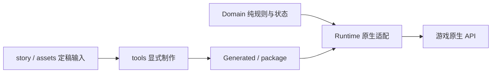

# 项目手册

这是当前项目需求、架构和工作流程的唯一说明入口。用户的新决定优先；接受变更后先更新对应定稿输入和本手册，再修改实现。历史说明、下载目录里的草稿和 `.dev` 里的反编译参考不能覆盖当前定稿。生成文件和测试报告也不构成新需求。

## 当前范围

当前版本以 `package/XiaomanVisitor/manifest.xml` 为准，不在多份说明中重复维护版本号。工坊条目 `3835383562` 的发布基线保存在 `main`，每次发布以 `v*` 标签留档；开发使用 `develop/tavern`。`baseline/native-render-0.0.3.3` 保存作者确认清晰的渲染方案，`baseline/pre-architecture-0.0.3.4` 保存本次整理前的工程。

| 状态 | 内容 |
| --- | --- |
| 已实现 | 十四次周一来访、固定预算、三语文字、107 条离线日语录音、次日纸条与十四盘磁带、六款三日效果饮品、信笺簿、磁带盒。 |
| 实验性功能 | 酒馆默认关闭。在模组设置“实验性 / Experimental”中开启“小满的酒馆（实验性）”，重启游戏后从第 1 天开放。包含分层场景、35 CR 普通杯、一次性取餐台协作和账本，每晚最多一项付费/协作活动。 |
| 发布计划 | 酒馆正式开放仍计划第 3 天；测试开放日不等于营业财周。 |
| 候选设计 | NPC 订单、客流项目、隔间转租、贷款重组、留下分支、分红和物业收购尚未实现。参考 `docs/design` 与 `story/酒馆设计`，不得描述为现有功能。 |

来访按实际见面推进：周一未营业或没见到小满就保留章节；首次开场真正播放后推进一次。她追加到原生队尾，不减少名额，不越过其他剧情顾客。同一天不能重复推进。剧情赠礼不要求成交，次日投递；放不下时保留断点，读档不能重复发放。

酒馆开关使用原生模组配置 `experimental_tavern`，初始值为关闭；每次启用模组时读取并固定本次会话的选择，更改后重启生效。关闭时不注册地点、不创建场景，也不初始化酒馆存档。过去的酒馆记录保留，重新开启后继续；十四次周一来访、纸条、磁带和回礼酒独立运行。

酒馆人物台词使用小满身旁、靠近吧台的原生姓名牌与对话气泡，姓名牌和正文整体避开脸部，复用原版打字机、文字动画、对话速度和气泡大小设置。侧边面板只放操作和经营状态。气泡副本的原生交易回调必须断开；酒馆对话独立拥有语音和关闭流程，点击或原版继续键可补全文字/结束台词，离场时一起清理，不借用当前顾客或推进周一剧情。

持枪反应测试经作者确认接入：只在当铺接待小满时允许抬枪，暂不允许开火。保持不可逮捕，通过原生 `forceShootable`、`unholsterDialogue`、`holsterResumesDialogue` 接入瞄准与对话暂存；同时守住 `CanShoot` 和 `Shoot`，不触发枪火、伤害或追捕。台词以 `story/持枪反应.json` 的三语文本为准，暂不配新音。美术采用原作担心眼神、小汗滴和刘海间的额头冷色阴影；口型跟随原生字符事件，标点停顿及说完闭嘴。收枪先回应，再续接原生暂存对话；快速反复抬枪不能覆盖原对话或重复推进章节和赠礼。普通顾客不受影响。

持枪美术以作者选定的 0.0.3.14 原作担心表情、眼睛和小汗滴为基线，仅调整刘海之间露出的额头阴影。按作者箭头标注，将阴影抬到两侧刘海缝隙的上半截，发根附近最浓，向眉毛方向逐渐变浅，下缘更早结束；额头亮斑一并压暗。保留原十八帧与正常立绘文件，以及六帧持枪图集的两种原作眼神和三档原口型。新增范围仅限原先漏掉的上方裸露额头，头发、眉毛线条、眼白、蓝色虹膜、脸型、汗滴与口型均保持基线。停止使用生成脸，也不继续使用扩眼、缩瞳和放大汗滴的像素稿。

新素材先查看与上一版同尺度的对比图及额头细节，再准备测试包。离线检查要求差异仅限额头皮肤，上部明显深于下部，下缘恢复原色；原眼睛、小汗滴、三档嘴型、身体和轮廓保持基线，口型切换不能带动眉眼或阴影。普通像素/哈希检查不能代替画面验收，美术是否合格仍由作者确认。

位置、身体、像素采样、材质、走动和柜台遮挡沿用现有原生路径；六帧在制作时组合完成，运行时只切换完整 Sprite。新图集按需加载、沿用原 pivot/PPU，停用时释放，不引入 UI 人物叠层。订阅模组“可能是收书的”（3835157116）的本机包用于核对完整表情 Sprite 与原生渲染的切换方式，不复制对方角色图片或代码。

持枪接口与配音等待需要包含 2026-11-08 原生 Mod API 更新的游戏版本。等待统一交给 `ModHelper` 的模组归属协程，检查同时拒绝扫描器的 `Pending` 提示；不增加后台运行或文件权限。此分支仅提交 PR，不自动安装、启动游戏或上传工坊，实机按验收附件由作者进行。

作者另行要求提供可单独启用的测试模组。`tools/build-gun-test.ps1` 编译相同的持枪、立绘及原生渲染模块，改用 `tools/gun-test` 的独立入口，ID 为 `sansm.xiaoman.gun_test`，文件夹为 `XiaomanGunTest`。它不编译主线、赠礼、交易、酒馆或配音模块，不读写主模组进度；任何日期营业时追加测试访客，`Ctrl+Shift+M` 可补邀，仍保留原生顾客顺序。主模组和测试版由作者在游戏里切换启用。测试包只附立绘和字幕，不重复携带音乐。

`build-gun-test.ps1` 默认只构建、检查并生成 ZIP；显式 `-Install` 只写入独立测试文件夹并核对哈希，不修改主模组或游戏启用设置。相同文件跳过；游戏运行时仅允许 DLL 哈希完全相同的素材更新，新图仍须重启加载，DLL 有变更则要求先保存退出。共享立绘注册与动画代码在 `XiaomanPortraitRuntime.cs`，两个入口共用，避免测试版与 PR 演出实现分叉。

第一至十四次初始预算为 150、200、250、300、350、400、450、500、450、400、350、300、250、200。当前收购需求、曲目顺序由 `story/来访安排.json` 维护。第 4 次固定售出两款不同果汁版饮品；第 5—13 次通常有 30% 概率售出两款，唯独第 6 次不售酒、次日固定赠送一杯随机酒精版。第 14 次附赠三款酒精版，随后原离站剧情结束，不继续发普通回礼。

普通回礼按该次接待的有效购买数量、实付金额和主动让利比例选一杯，次日送达。只统计玩家向小满出售物品的交易；她卖出的酒、酒馆消费不计入。

| 条件 | 果汁版门槛与效果 | 酒精版门槛与效果 |
| --- | --- | --- |
| 主动让利比例 | 10%：青色雨幕，交易声望收益 +10% | 25%：放晴天空，交易声望收益 +20% |
| 同次接待累计成交件数 | 3 件：鲸鱼之梦，每日拾荒次数 +2 | 6 件：宇宙空间，每日拾荒次数 +4 |
| 同次接待实付信用点 | 100 CR：蔚蓝日落，幸运 +5 | 200 CR：幸运青鸟，幸运 +8 |

全未达标就不送普通酒；多类同时达标时，先选酒精版，再比较各自达到门槛的倍数。完全相同则按上一杯回礼所属类别循环轮换，首次顺序为让利、数量、金额。预算不足造成的少付不算主动让利。第 6、14 次的固定赠酒覆盖普通回礼。

效果含饮用当天持续 3 天；不同类叠加，同类后喝替换并重置。物品属烟酒，杯身 1×2；效果和感受写在物品说明，饮用不弹纸条。对应实现为 Domain 的 `CocktailCatalog`、`DrinkRewardRules`；调整时同步本表和边界回归，不能只改提示文案。

## 定稿输入与生成边界

| 输入 | 负责内容 | 生成/使用者 |
| --- | --- | --- |
| `story/小满的十四个星期一_v3.4_专属动作台词_TTS演出整合.md` | 中日口头台词、表情、演出，以及纸条称呼与署名。文件名是作者稿本版本。 | `tools/prepare_story.py` |
| `story/来访安排.json` | 十四次来访的预算、需求、磁带映射。 | 同上；禁止另写一套自动周数预算。 |
| `story/英文台词.json` | 英文口头台词与专属动作文本。 | 同上 |
| `story/持枪反应.json` | 本轮瞄准与收枪反应的三语字幕、演出及暂不配音约定。 | `tools/prepare_story.py`；不加入旧动作池或借播不匹配的录音。 |
| `story/纸条正文.json` | 三语纸条正文，优先于稿件中保留的旧正文段落。 | 同上 |
| `story/配音脚本_ja.json`、`assets/audio` 的录音及元数据 | 口播、审核状态、速度、字幕绑定与原始音频。 | `tools/voice_pipeline.py`；只有显式 `generate` 才可请求 TTS。 |
| `story/酒馆配音脚本_ja_待审.json` | 酒馆新口头台词候选。 | 待作者审核；不能直接覆盖完整配音索引。 |
| `assets` 的图像/音乐原料、样式、清单及哈希 | 立绘、饮品、信纸、字体、曲目与场景的制作依据。 | 相应 `prepare_*`；普通构建不重新提取原作。 |
| `assets/item-presentation.json`、`assets/tavern-map-localization.json` | 酒品/收藏物品和酒馆界面的三语展示模板。 | `tools/apply_item_presentation.py`；剧情制作也调用同一模板。 |
| `package/XiaomanVisitor/Localization` | 未纳入上述定稿的通用界面文本。 | 剧情制作保留这些通用键；已生成的剧情键仍从定稿修改。 |

`assets/story.json` 是剧情快照；`src/Generated` 是编译目录；`package` 是运行资源。生成后检查差异，再执行完整校验。图片、录音与玩家已确认文本不因工程整理而重做。旧版首次成交/随机磁带机制已经退出运行流程；保留旧物品 ID 和仍在使用的存档迁移。

制作命令按需执行，不要把所有 `prepare_*` 一次性重跑。口头剧情变更从定稿与来访安排开始；纸条正文从三语 JSON 开始；物品展示从模板开始。`prepare_story.py` 更新故事绑定、目录及本地化，必要时更新手写页。口播调整后用 `voice_pipeline.py status` 检查绑定，先审稿再生成录音；运行模组只播放现成文件。具体 CLI 参数以脚本 `--help` 为准。

## 架构与所有权



| 层 | 职责与约束 |
| --- | --- |
| `src/Domain` | 章节、交易奖励、酒效、容器准入、音频口型等可验证规则与序列化快照；允许 BCL/JSON 和稳定身份常量，禁止 Unity/原生游戏副作用。 |
| `src/Runtime` | 唯一 IMod 生命周期入口 `XiaomanVisitor.cs`，以及顾客/物品/存档钩子、原生 UI、渲染、音频与资源生命周期。现有 partial class 按功能协作，不扩建服务容器。 |
| `src/Generated` | 从定稿生成的剧情和磁带目录，禁止只改这里而不改输入。 |
| `tests` | 核心场景、原生绑定兼容、配音工具与依赖边界；不是运行模组的一部分。 |
| `.dev` / `release` | 本机环境、临时检查程序、当前报告、备份与发布归档，不入 Git。 |

只有 Runtime 把状态交给 ModHelper。存档持有字符串、整数、布尔值或明确 JSON，不把 Unity 对象写入存档。命名空间、物品 ID、现有数据键保持；尤其 `story_v34_progress` 的 `v34` 是稿本/存档契约，不跟着模组版本改名。Domain 与 Runtime 保持同一程序集，不为这些目录额外增加接口层、依赖注入或运行 DLL。

三种时钟必须分开：游戏日来自原生 `dayCounter`；章节序号来自实际见面次数；未来财周属于尚未接入的经营模型。周一缺席不会补刷多章，也不能通过简单的日期除以七推定她已经来过。

资源归模组统一所有：店铺 Sprite 与酒馆演员共用一套高清图集；优先柔和定稿、再尝试最近邻后备，最后回退低分。帧与酒馆场景停止使用后，由模组统一释放图集。音频录制工具与运行播放完全分离，密钥不进入运行包。

店铺沿用原生 SpriteRenderer、材质、进出场、暗影渐亮与前景排序。只在小满可见时临时采用原生非像素相机模式；人物离开、特殊视窗或停用时恢复，接待期间更改的显示选择也要保留。原生会在走出前清空当前顾客，所以离场还须根据显示中的小满图集判断所有权。禁止重新叠 UI 立绘或手工柜台裁切。该方案提升的是整台主摄像机的渲染分辨率，性能证据与取舍见[渲染复盘](渲染问题复盘与性能取舍.md)。

## 开发、检查与发布

遇到显示或原生流程问题，先建立最小复现，核对游戏原生入口、当前安装包和日志，再修改一个相关环节。已观察事实、待验证推测和已放弃方案分开记录；没有证据时不把原因写成结论。画面改动以已验证基线对比，代码检查通过不等于实机画面通过。

```powershell
& .\tools\setup-dev.ps1 -GameRoot '<自己的游戏安装目录>'
& .\tools\verify-dev.ps1          # 日常：构建 + 原生兼容 + 关键回归 + 离线配音工具
& .\tools\verify-dev.ps1 -Full    # 文本、素材或发布：再校验全部资源
```

日常检查保留真实失败边界：延期/终章、原生队列、部分赠礼与读档、奖励阈值和叠加、文本与旧录音绑定、进出场采样及设置恢复。测试只需代表性完整流程与边界，不重复大量随机种子，也不保留未调用的旧规则测试。原生方法和解析器直接使用本机游戏程序集校验；没有游戏安装时不能声称这部分通过。

完整校验增加三语文本、原图与帧映射、42 张手写纸条、107 条录音和场景素材核对。检查不安装、不生成付费录音、不上传。当前配音报告在 `.dev/reports/voice-audio.json`，发布时复制进相应 `release` 目录；不再在剧情目录或 Git 中累积每个版本的重复报告。检查程序输出在 `.dev/checks`。

需要实机测试时显式运行 `tools/build.ps1 -Install`；游戏占用 DLL 时先保存退出，不能强退。实机按[验收清单](实机验收.md)由作者进行；离线检查不替代画面验收。默认保留已验证安装版，工程整理不会自动覆盖它。

开发包用 `.venv/Scripts/python.exe tools/package_voice_release.py --development --skip-installed-check` 准备，先运行完整校验。去掉 `--skip-installed-check` 会要求安装文件与当前构建完全一致。工坊上传单独使用发布工具，必须有作者明确发布请求；不要在构建/测试中加入上传。

工坊发布只更新现有条目。先用 `tools/publish-workshop.ps1 -Action inspect -Language schinese`（以及 `english`）读取线上标题、介绍与图片顺序，快照放在 `.dev/reports`，保留作者后来修改的内容。各语种的工坊页面文件放在对应 `release` 目录；`publish` 上传运行包，`metadata` 仅同步指定语种文案，`verify` 回读确认。查询和提交都必须指定语言，见 [Steam 官方接口说明](https://partner.steamgames.com/doc/api/ISteamUGC#SetItemUpdateLanguage)；工具默认 `schinese`，不依赖 Steam 客户端语言。发布后更新归档状态，将已发布源码同步到 `main` 并建立版本标签。

所有图片、音频、字体用 Git LFS。源码仓库不放游戏程序集、反编译参考、个人存档、密钥、工具链缓存或发布 ZIP。原作素材与字体来源说明保留在运行包。历史说明、旧需求、已移除的一次性脚本见[历史索引](history/README.md)，不作为当前任务指令。
